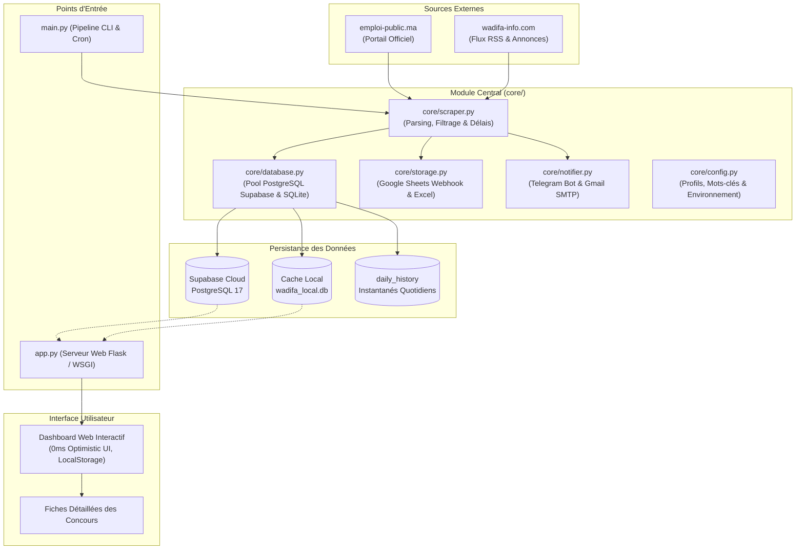

<div align="center">

# WadifaBot Maroc

**Système Autonome de Veille et d'Agrégation des Concours de la Fonction Publique au Maroc**

[](https://www.python.org/)
[](https://flask.palletsprojects.com/)
[](https://www.postgresql.org/)
[](https://supabase.com/)
[](https://tailwindcss.com/)
[](https://github.com/features/actions)
[](LICENSE)

<p align="center">
  Agrégation intelligente, déduplication, filtrage par profil technique et tableau de bord haute performance avec historique quotidien et alertes multi-canaux.
</p>

</div>

---

## Sommaire

- [Présentation](#présentation)
- [Architecture du Système](#architecture-du-système)
- [Fonctionnalités Clés](#fonctionnalités-clés)
- [Structure du Projet](#structure-du-projet)
- [Guide d'Installation Rapide](#guide-dinstallation-rapide)
- [Configuration des Variables d'Environnement](#configuration-des-variables-denvironnement)
- [Automatisation Cloud (GitHub Actions)](#automatisation-cloud-github-actions)
- [Sécurité et Confidentialité](#sécurité-et-confidentialité)
- [Stack Technologique](#stack-technologique)

---

## Présentation

**WadifaBot Maroc** est une plateforme autonome conçue pour automatiser la surveillance des opportunités d'emploi dans le secteur public marocain. Le système interroge quotidiennement les deux sources officielles et de référence :

1. **Portail Officiel du Recrutement Public :** [emploi-public.ma](https://www.emploi-public.ma/)
2. **Portail National d'Emploi :** [wadifa-info.com](https://www.wadifa-info.com/)

Le moteur cible avec précision le profil technique **Développement Digital / Web Full Stack / Informatique** (grades de Technicien de 3ème grade, Technicien Spécialisé, Bac+2 DUT/BTS/EST/ISTA et licences informatiques).

---

## Architecture du Système



---

## Fonctionnalités Clés

### 1. Collecte et Déduplication Intelligente
- Surveillance automatique multi-sources (`emploi-public.ma` + `wadifa-info.com`).
- Normalisation et extraction des dates arabes et ISO (ex: `8 نونبر 2026`).
- Détection des dates limites avec calcul dynamique du temps restant.
- Déduplication automatique des annonces publiées simultanément sur plusieurs plateformes.

### 2. Tableau de Bord Web Haute Performance (0ms Latency)
- **Architecture Stale-While-Revalidate :** Chargement instantané à la milliseconde zéro depuis le `localStorage` du navigateur.
- **Mises à Jour Optimistes (Optimistic UI) :** Bascule instantanée des favoris et du statut des candidatures sans attendre la réponse serveur.
- **Recherche et Filtrage As-You-Type :** Filtrage instantané en temps réel par mot-clé, ministère, organisme, source ou degré d'urgence.
- **Modes d'Affichage :** Basculement fluide entre la vue en cartes Bento et la vue tabulaire dense.
- **Raccourcis Clavier :** Navigation rapide (`/` pour chercher, `Esc` pour fermer les modales, `1-4` pour commuter entre les onglets).

### 3. Historique Quotidien Détaillé (Daily Snapshots)
- Enregistrement systématique de chaque exécution dans la base Supabase PostgreSQL.
- **Instantané complet des offres :** Conservation des concours exacts trouvés chaque jour avec titre, organisme, grade, date limite et lien officiel.
- Consultation et inspection rétrospective de chaque session via une modale dédiée.

### 4. Alertes et Notifications Multi-Canaux
- **Telegram Bot :** Messages instantanés avec liens directs et encodage UTF-8 sécurisé.
- **Gmail SMTP :** Rapport formaté par e-mail avec résumé des concours actifs et liens d'accès.
- **Google Sheets :** Synchronisation cloud via Webhook Google Apps Script pour suivi mobile.
- **Export Excel :** Génération locale et téléchargement immédiat du fichier `.xlsx`.

### 5. Base de Données Hybride & Pool de Connexions
- Connexion primaire à **Supabase PostgreSQL 17** via un pool de connexions multithread (`ThreadedConnectionPool`).
- Miroir local ultra-rapide sur **SQLite** assurant la continuité de service en cas de coupure réseau.

---

## Structure du Projet

```text
wadifa-pulse/
├── core/                           # Package central (Architecture modulaire)
│   ├── __init__.py                 # Interface d'export du package
│   ├── config.py                   # Configuration centralisée & validation
│   ├── database.py                 # Couche données (PostgreSQL 17 + SQLite)
│   ├── scraper.py                  # Moteur d'extraction (emploi-public.ma & wadifa-info)
│   ├── notifier.py                 # Modules d'alerte (Telegram, Gmail, WhatsApp)
│   └── storage.py                  # Synchronisation Google Sheets & Excel
├── templates/                      # Vues HTML (Jinja2)
│   ├── index.html                  # Tableau de bord administratif interactif
│   └── login.html                  # Portail d'authentification sécurisé
├── .github/
│   └── workflows/
│       └── daily_concours.yml      # Cron CI/CD quotidien GitHub Actions
├── app.py                          # Serveur d'application Web Flask & API REST
├── main.py                         # Point d'entrée CLI & Cron de veille
├── requirements.txt                # Dépendances Python de production
├── Procfile                        # Configuration déploiement Cloud (Render/Railway)
├── Lancer_Application.bat          # Lanceur Windows en 1 clic
├── .env.example                    # Gabarit des variables d'environnement
├── .gitignore                      # Règles d'exclusion Git strictes
└── README.md                       # Documentation d'architecture complète
```

---

## Guide d'Installation Rapide

### Prérequis
- Python 3.10 ou version ultérieure
- Un navigateur web moderne (Chrome, Firefox, Edge, Safari)

### Option 1 : Lancement en 1 Clic (Windows)
Double-cliquez simplement sur le fichier :
```cmd
Lancer_Application.bat
```
Le script installe automatiquement les dépendances requises, lance le serveur local et ouvre l'interface sur `http://127.0.0.1:5000`.

### Option 2 : Installation Manuelle (Linux / macOS / Windows)

1. **Cloner le dépôt :**
   ```bash
   git clone https://github.com/abdelkhalek-hub1/wadifa-bot.git
   cd wadifa-bot
   ```

2. **Créer et activer un environnement virtuel :**
   ```bash
   python -m venv .venv
   # Windows :
   .venv\Scripts\activate
   # Linux / macOS :
   source .venv/bin/activate
   ```

3. **Installer les dépendances :**
   ```bash
   pip install -r requirements.txt
   ```

4. **Configurer l'environnement :**
   ```bash
   cp .env.example .env
   # Complétez les variables dans .env
   ```

5. **Démarrer l'application web :**
   ```bash
   python app.py
   ```
   Rendez-vous ensuite sur `http://127.0.0.1:5000/login`.

---

## Configuration des Variables d'Environnement

Créez un fichier `.env` à la racine du projet avec les clés suivantes :

```ini
# ==========================================
# Notifications Telegram
# ==========================================
TELEGRAM_ENABLED=true
TELEGRAM_BOT_TOKEN=votre_token_bot_telegram
TELEGRAM_CHAT_ID=votre_chat_id_telegram

# ==========================================
# Notifications Email (Gmail SMTP)
# ==========================================
EMAIL_ENABLED=true
SMTP_SERVER=smtp.gmail.com
SMTP_PORT=465
EMAIL_SENDER=votre.email@gmail.com
EMAIL_PASSWORD=votre_mot_de_passe_application_16_caracteres
EMAIL_RECIPIENT=votre.email@gmail.com

# ==========================================
# Synchronisation Google Sheets
# ==========================================
GOOGLE_SHEETS_ENABLED=true
GOOGLE_SHEET_WEBHOOK_URL=https://script.google.com/macros/s/votre_id_script/exec
```

---

## Automatisation Cloud (GitHub Actions)

Le fichier `.github/workflows/daily_concours.yml` est préconfiguré pour exécuter la veille chaque matin à **08:00 UTC** sans intervention humaine.

Pour activer l'automatisation cloud :
1. Poussez le code sur votre dépôt GitHub :
   ```bash
   git push origin master
   ```
2. Allez dans **Settings > Secrets and variables > Actions > New repository secret**.
3. Ajoutez les secrets suivants :
   - `TELEGRAM_ENABLED`
   - `TELEGRAM_BOT_TOKEN`
   - `TELEGRAM_CHAT_ID`
   - `EMAIL_ENABLED`
   - `EMAIL_SENDER`
   - `EMAIL_PASSWORD`
   - `EMAIL_RECIPIENT`
   - `GOOGLE_SHEETS_ENABLED`
   - `GOOGLE_SHEET_WEBHOOK_URL`

---

## Sécurité et Confidentialité

- **Hachage Cryptographique :** Les mots de passe sont hachés de manière irréversible via PBKDF2/Werkzeug. Aucun mot de passe en clair n'est stocké dans le code ni dans les dépôts publics.
- **Séparation des Secrets :** Les identifiants sensibles (`.env`, bases de données locales, tokens) sont strictement ignorés par `.gitignore`.
- **Chiffrement en Transit :** Toutes les communications avec la base Supabase PostgreSQL utilisent SSL forcé (`sslmode=require`).
- **Isolation de Session :** Les sessions web utilisent des cookies sécurisés avec protection CSRF et contrôle d'accès strict (`@login_required`).

---

## Stack Technologique

| Composant | Technologie | Description |
| :--- | :--- | :--- |
| **Backend** | Python 3.10+ & Flask 3 | Serveur d'application et API REST modulaire |
| **Scraping** | BeautifulSoup4, Requests, Urllib | Parsing HTML/XML et normalisation des flux |
| **Base Cloud** | Supabase (PostgreSQL 17) | Persistance relationnelle cloud et pool de connexions |
| **Base Locale** | SQLite 3 | Cache miroir instantané hors-ligne |
| **Frontend** | Tailwind CSS & Phosphor Icons | Interface Bento Grid sans dépendance lourde |
| **Typographie** | Plus Jakarta Sans | Police moderne optimisée pour la lisibilité |
| **Alertes** | Telegram Bot API & SMTP SSL | Canaux de notification push instantanés |
| **Reporting** | OpenPyXL & Google Sheets Webhook | Génération automatisée de feuilles de calcul |
| **CI/CD** | GitHub Actions | Automatisation planifiée 24h/24 et 7j/7 |

---

<div align="center">
  <sub>Développé avec rigueur pour optimiser l'accès aux opportunités de la fonction publique marocaine.</sub>
</div>
