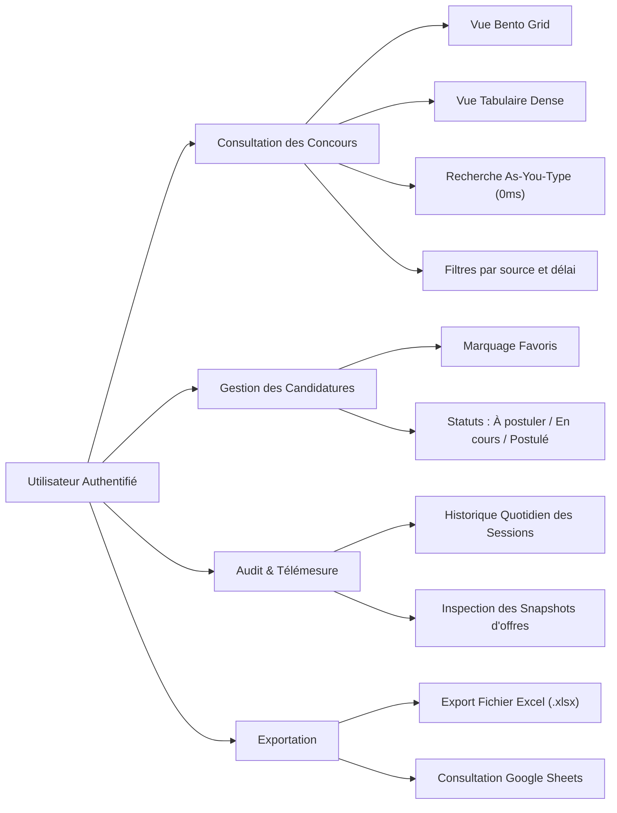
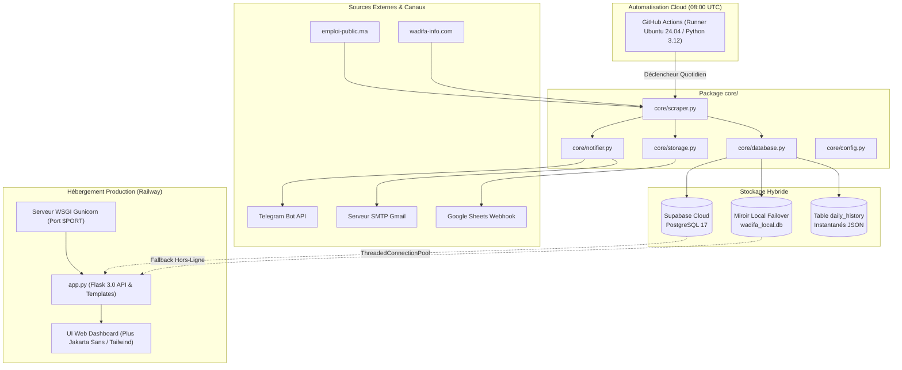

# Cahier des Charges Fonctionnel et Technique (CdCFT)
## Projet : Wadifa Pulse / WadifaBot Maroc
**Plateforme Autonome de Veille Stratégique et de Gestion des Concours de la Fonction Publique au Maroc**

---

### Informations Générales du Projet

| Métadonnée | Valeur |
| :--- | :--- |
| **Nom de code du projet** | Wadifa Pulse (`emploi-public` / `wadifa-pulse`) |
| **Porteur du projet** | Abdelkhalek Ouaraqy |
| **Version actuelle** | 2.4 (Production Ready) |
| **Profil ciblé** | Développement Digital / Web Full Stack / Informatique |
| **Statut d'hébergement** | Production active sur Railway (`emploi-public-production.up.railway.app`) |
| **Dépôt Git source** | `https://github.com/abdelkhalek-hub1/emploi-public` |

---

## 1. Contexte & Objectifs Stratégiques

### 1.1 Problématique
Au Maroc, les opportunités d'emploi dans le secteur public (ministères, régies autonomes, universités, collectivités territoriales, offices nationaux) sont publiées de manière dispersée sur plusieurs plateformes. Les candidats rencontrent trois défis majeurs :
1. **Dispersion des sources :** Obligation de consulter manuellement et quotidiennement plusieurs portails (`emploi-public.ma`, `wadifa-info.com`).
2. **Délais de candidature stricts et courts :** Les délais varient entre 7 et 20 jours. Un retard de détection entraîne l'échéance de l'avis de recrutement.
3. **Absence de filtrage par spécialité réelle :** Les plateformes officielles ne disposent pas d'alertes instantanées ciblées spécifiquement sur le profil **Technicien Spécialisé 3ème grade en Développement Digital / Web**.

### 1.2 Objectifs de la Solution
- **Automatisation totale :** Indexation automatique quotidienne multi-sources sans intervention humaine.
- **Normalisation & Déduplication :** Traitement algorithmique pour unifier les annonces et éliminer les doublons inter-plateformes.
- **Alertes instantanées multi-canaux :** Notification directe sur smartphone via Telegram Bot, rapport matinal par e-mail (Gmail SMTP) et synchronisation en direct sur Google Sheets.
- **Tableau de bord de souveraineté :** Interface web à latence nulle (0ms) avec persistance locale, gestion des statuts de candidature, favoris et historique rétrospectif des sessions d'agrégation.

---

## 2. Périmètre Fonctionnel (Spécifications Métier)

### 2.1 Sources de Données Indexées
1. **emploi-public.ma** : Portail officiel du recrutement dans les administrations et établissements publics marocains.
2. **wadifa-info.com** : Portail national de référence agrégeant les concours de la fonction publique et du secteur semi-public.

### 2.2 Critères de Qualification et Profil Cible
Le système filtre et valide les annonces répondant aux critères stricts suivants :
- **Spécialité :** Informatique, Développement Web, Full Stack, Systèmes et Réseaux, Technologies de l'information.
- **Grades & Diplômes :**
  - Technicien de 3ème grade (Échelle 9)
  - Technicien Spécialisé (DTS / BTS / DUT / EST / ISTA)
  - Bac+2 et Bac+3 / Licences professionnelles informatiques.
- **Validité temporelle :** Date limite de candidature strictement supérieure ou égale à la date du jour (`deadline >= today`).

### 2.3 Traitement des Dates et Calcul des Échéances
- Prise en charge des dates écrites en arabe (`13 نونبر 2026`) et en format ISO / standard (`31/10/2026`).
- Calcul dynamique du délai restant : $\text{Délai} = \text{Date Limite} - \text{Date du Jour}$.
- Classification de priorité :
  - **Critique / Urgent :** $\le 3$ jours restants (Badge rouge).
  - **Moyen / Proche :** $4 \le \text{Délai} \le 7$ jours (Badge jaune/ambre).
  - **Confortable :** $> 7$ jours (Badge vert émeraude).

### 2.4 Matrice des Fonctionnalités Utilisateur



---

## 3. Architecture Technique & Flux de Données

### 3.1 Diagramme d'Architecture Globale



### 3.2 Modèle de Données (Base de Données PostgreSQL 17 / Supabase)

#### Table `jobs` (Registre des Concours Actifs)
| Colonne | Type | Description |
| :--- | :--- | :--- |
| `id` | `VARCHAR(255) PRIMARY KEY` | Identifiant unique généré par hachage MD5 |
| `organism` | `TEXT NOT NULL` | Ministère, organisme ou administration recruteuse |
| `grade` | `TEXT NOT NULL` | Intitulé officiel du poste et grade |
| `diplomas` | `TEXT` | Diplômes exigés |
| `specialties` | `TEXT` | Spécialités techniques ciblées |
| `deadline` | `DATE NOT NULL` | Date limite de dépôt de candidature |
| `deadline_str` | `VARCHAR(50)` | Date formatée (`DD/MM/YYYY`) |
| `days_left` | `INTEGER` | Nombre de jours restants calculé |
| `source` | `VARCHAR(50)` | Source (`emploi-public` ou `wadifa-info`) |
| `link` | `TEXT NOT NULL` | Lien officiel pour postuler |
| `date_found` | `DATE NOT NULL` | Date de première détection |
| `is_favorite` | `BOOLEAN DEFAULT FALSE` | Statut de favori de l'utilisateur |
| `application_status` | `VARCHAR(50) DEFAULT 'a_postuler'` | Statut de la candidature |
| `created_at` | `TIMESTAMP DEFAULT NOW()` | Horodatage de création |

#### Table `daily_history` (Audit & Instantanés Quotidiens)
| Colonne | Type | Description |
| :--- | :--- | :--- |
| `id` | `SERIAL PRIMARY KEY` | Identifiant séquentiel de session |
| `run_date` | `VARCHAR(20) NOT NULL` | Date d'exécution (`DD/MM/YYYY`) |
| `total_jobs` | `INTEGER NOT NULL` | Nombre total de concours actifs détectés |
| `new_jobs` | `INTEGER NOT NULL` | Nombre de nouveaux concours sur cette session |
| `urgent_jobs` | `INTEGER NOT NULL` | Nombre de concours dont l'échéance est $\le 3$ jours |
| `sources` | `TEXT` | Sources interrogées |
| `jobs_snapshot` | `JSONB / TEXT` | Instantané JSON complet de toutes les offres de la session |
| `created_at` | `TIMESTAMP DEFAULT NOW()` | Horodatage exact de l'exécution |

#### Table `users` (Authentification & Contrôle d'Accès)
| Colonne | Type | Description |
| :--- | :--- | :--- |
| `id` | `SERIAL PRIMARY KEY` | Identifiant administrateur |
| `email` | `VARCHAR(255) UNIQUE NOT NULL` | Adresse e-mail d'authentification |
| `password_hash` | `TEXT NOT NULL` | Hachage sécurisé PBKDF2:SHA256 |
| `created_at` | `TIMESTAMP DEFAULT NOW()` | Date de création du compte |

---

## 4. Charte Graphique & Système de Design

### 4.1 Direction Artistique : "Sovereign Observatoire"
L'interface s'affranchit des styles génériques d'IA (dégradés violets criards, formes flottantes et emojis omniprésents) pour adopter une **esthétique institutionnelle, sobre et technique** inspirée des meilleurs outils d'ingénierie contemporains (Linear, Vercel, Stripe).

- **Typographie :**
  - **Titres & Textes courants :** `Plus Jakarta Sans` (Clarté, géométrie humaniste, excellente lisibilité des textes bilingues français/arabe).
  - **Données, Métriques & Code :** `JetBrains Mono` (Données chiffrées tabulaires, horodatages, badges techniques).
- **Zéro Emoji :** Remplacement systématique de tous les emojis par la bibliothèque d'icônes vectorielles nettes **Phosphor Icons**.

---

### 4.2 Palette de Couleurs Complète (Design System Tokens)

```
[ Primary Sovereign Emerald ]
#047857 ──── rgb(4, 120, 87)    ── Tailwind: emerald-700 (Actions, Boutons principaux)
#064e3b ──── rgb(6, 78, 59)     ── Tailwind: emerald-900 (Logo Masthead, Header Accent)
#10b981 ──── rgb(16, 185, 129)  ── Tailwind: emerald-500 (Télémétrie active, Succès)
#dcfce7 ──── rgb(220, 252, 231) ── Tailwind: emerald-100 (Badge échéance confortable)

[ Dark Canvas & Surfaces (Login & Dark Mode) ]
#020617 ──── rgb(2, 6, 23)      ── Tailwind: slate-950   (Fond d'écran principal auth)
#0f172a ──── rgb(15, 23, 42)    ── Tailwind: slate-900   (Cartes sombres, Surfaces de saisie)
#1e293b ──── rgb(30, 41, 59)    ── Tailwind: slate-800   (Bordures actives, Inputs focus)
#334155 ──── rgb(51, 65, 85)    ── Tailwind: slate-700   (Séparateurs discrets)

[ Light Canvas & Dashboard Surfaces ]
#f8fafc ──── rgb(248, 250, 252) ── Tailwind: slate-50    (Fond général du Dashboard)
#ffffff ──── rgb(255, 255, 255) ── Tailwind: white       (Cartes Bento, Conteneurs tableaux)
#e2e8f0 ──── rgb(226, 232, 240) ── Tailwind: slate-200   (Bordures des cartes et séparateurs)
#f1f5f9 ──── rgb(241, 245, 249) ── Tailwind: slate-100   (En-têtes de tableau, Badges neutres)

[ Semantic Accents & Statuses ]
#dc2626 ──── rgb(220, 38, 38)   ── Tailwind: red-600     (Échéance imminente <= 3 jours)
#fee2e2 ──── rgb(254, 226, 226) ── Tailwind: red-100     (Fond badge critique)
#d97706 ──── rgb(217, 119, 6)   ── Tailwind: amber-600   (Échéance proche <= 7 jours, Favoris)
#fef3c7 ──── rgb(254, 243, 199) ── Tailwind: amber-100   (Fond badge alerte modérée)
#1d4ed8 ──── rgb(29, 78, 216)   ── Tailwind: blue-700    (Source officielle emploi-public.ma)
#eff6ff ──── rgb(239, 246, 255) ── Tailwind: blue-50     (Fond badge source officielle)
```

#### Tableau Récapitulatif des Couleurs

| Rôle Visuel | Code HEX | Code RGB | Classe Tailwind | Utilisation Principale |
| :--- | :--- | :--- | :--- | :--- |
| **Primaire Institutionnel** | `#047857` | `rgb(4, 120, 87)` | `bg-emerald-700` | Boutons d'action, CTA, accents dominants |
| **Accent Marque** | `#064e3b` | `rgb(6, 78, 59)` | `bg-emerald-900` | Badge de marque, en-têtes d'observatoires |
| **Télémétrie & Online** | `#10b981` | `rgb(16, 185, 129)` | `text-emerald-500` | Statut de connexion active, point vert de télémétrie |
| **Surface Dark (Fond)** | `#020617` | `rgb(2, 6, 23)` | `bg-slate-950` | Arrière-plan de la page d'authentification |
| **Surface Dark (Carte)** | `#0f172a` | `rgb(15, 23, 42)` | `bg-slate-900` | Cartes de connexion, champs de saisie sombres |
| **Surface Light (Fond)** | `#f8fafc` | `rgb(248, 250, 252)`| `bg-slate-50` | Arrière-plan global du tableau de bord |
| **Surface Blanche** | `#ffffff` | `rgb(255, 255, 255)`| `bg-white` | Fond des cartes Bento, modales, tableau dense |
| **Bordures Subtiles** | `#e2e8f0` | `rgb(226, 232, 240)`| `border-slate-200` | Délimitation fine des cartes Bento et conteneurs |
| **Texte Principal** | `#0f172a` | `rgb(15, 23, 42)` | `text-slate-900` | Titres des concours, organismes, données clés |
| **Texte Secondaire** | `#64748b` | `rgb(100, 116, 139)`| `text-slate-500` | Sous-titres, dates limites, libellés de badges |
| **Alerte Critique** | `#dc2626` | `rgb(220, 38, 38)` | `text-red-600` | Concours avec délai $\le 3$ jours |
| **Alerte Modérée** | `#d97706` | `rgb(217, 119, 6)` | `text-amber-600` | Concours avec délai $\le 7$ jours, favoris |
| **Source Officielle** | `#1d4ed8` | `rgb(29, 78, 216)` | `text-blue-700` | Badge d'identification `emploi-public.ma` |

---

### 4.3 Composants d'Interface et Ergonomie (UX)
1. **Cartes Bento (Bento Grid) :**
   - Rayon de courbure contrôlé : `rounded-xl` ($12\text{px}$).
   - Ombre portée microscopique : `shadow-xs` / `shadow-sm` pour éviter l'effet "cartes flottantes d'IA".
2. **Architecture Optimiste (0ms Optimistic UI) :**
   - Mise en cache locale instantanée (`localStorage`).
   - Bascule immédiate des favoris et statuts sans attendre le retour réseau du serveur.
3. **Modale d'Inspection des Snapshots :**
   - Fond flouté (`backdrop-blur-sm bg-slate-950/60`).
   - Liste scrollable avec restitution exacte des avis capturés lors de la session.
4. **Raccourcis Clavier :**
   - `/` : Activer immédiatement la recherche.
   - `Esc` : Fermer les fenêtres modales.
   - `1`, `2`, `3`, `4` : Commuter entre les onglets de filtrage.

---

## 5. Spécifications de Sécurité & Performance

### 5.1 Sécurité de l'Application
- **Gestion des Secrets :** Aucun mot de passe ni clé d'API n'est stocké en clair dans le code ou dans le dépôt Git. Toutes les valeurs sensibles sont injectées via les variables d'environnement (`.env` localement, GitHub Repository Secrets pour CI/CD, et Railway Environment Variables pour la production).
- **Hachage des Mots de Passe :** Utilisation de l'algorithme `PBKDF2:SHA256` avec sel cryptographique (Werkzeug Security).
- **Protection contre les Injections SQL :** Utilisation exclusive de requêtes SQL paramétrées (`psycopg2` et `sqlite3`).
- **Gestion des Sessions :** Sessions chiffrées par cookie sécurisé avec clé `SECRET_KEY`.

### 5.2 Performance & Résilience
- **Connexion Réutilisable :** `ThreadedConnectionPool` (PostgreSQL) limitant le surcoût de négociation SSL à chaque requête.
- **Failover Local :** Bascule automatique et transparente vers `wadifa_local.db` (SQLite) en cas d'indisponibilité temporaire de la base de données cloud.
- **Serveur de Production :** Exécution sous **Gunicorn** multi-workers avec liaison dynamique sur le port alloué par la plateforme Cloud (`--bind 0.0.0.0:$PORT`).

---

## 6. Environnements & Déploiement

| Composant | Environnement | Technologie / Plateforme | Rôle |
| :--- | :--- | :--- | :--- |
| **Web Server (Production)** | Cloud PaaS | **Railway** | Serveur Flask WSGI accessible 24/7 en HTTPS |
| **Cron & Surveillance** | Serverless CI/CD | **GitHub Actions** | Exécution quotidienne à 08:00 UTC (09:00 Maroc) |
| **Base de Données Principale**| Cloud DBaaS | **Supabase (PostgreSQL 17)** | Stockage permanent des concours, sessions et utilisateurs |
| **Base de Données Fallback** | Local SQLite | **`wadifa_local.db`** | Continuité de service hors-ligne |
| **Canaux de Diffusion** | API Externe | **Telegram Bot + Gmail SMTP** | Alertes push sur smartphone et rapport e-mail |

---

## 7. Feuille de Route Stratégique des Versions (Roadmap)

### 7.1 Version 1.0 (Terminée & Déployée — Tag `v1.0.0`)
- Moteur de base monolithique d'agrégation d'offres (`emploi-public.ma` + `wadifa-info.com`).
- Tableau de bord Bento Grid et tabulaire haute performance.
- Authentification avec hachage sécurisé des mots de passe.
- Système d'alertes Telegram, Gmail SMTP et synchronisation Google Sheets.
- Identité visuelle institutionnelle souveraine : logo et emblème transparents haute définition, favicons multi-résolutions.
- Pipeline GitHub Actions cron planifié à 08:00 et 13:00 (GMT+1 Maroc).

### 7.2 Version 2.0 (Terminée & Déployée — Tag `v2.0.0`)
- **Architecture SaaS Multi-Tenant :** Inscription libre (`/signup`) et connexion sécurisée (`/login`).
- **Gestionnaire Dynamique de Préférences (`/settings`) :**
  - Sélection de profils cibles prédéfinis et personnalisés (Web Full Stack, Systèmes & Réseaux, Cybersécurité, Data).
  - Sélection des échelles et grades de la fonction publique (Technicien Spécialisé 3ème grade, Ingénieur d'État, Administrateur).
  - Filtrage par niveau d'études (Bac+2, Bac+3, Bac+5) et nuage de mots-clés dynamiques.
- **Canaux d'Alerte Personnalisés par Utilisateur :**
  - Intégration de son propre identifiant Telegram Chat ID et Token Bot dédié avec action de test immédiate.
  - Configuration de son email personnel de réception avec test direct en boîte de réception.
  - Lien Google Sheets privé par utilisateur.
- **Interactions Isolées par Utilisateur :**
  - Table `user_job_interactions` isolant les favoris (`is_favorite`) et les statuts (`status_applied`) par compte utilisateur.
- **Distributeur Multi-Utilisateurs (`dispatch_all_user_alerts`) :**
  - Moteur d'évaluation filtrant la liste globale des offres selon le profil individuel de chaque utilisateur actif avant transmission.

### 7.3 Version 3.0 (Prochaine Étape : Moteur d'Agrégation Multi-Plateformes — Engine Expansion)
Extension du moteur autonome pour couvrir l'intégralité du marché de l'emploi marocain (Public, Privé & Spécialisé) :

1. **Secteur Public & Semi-Public :**
   - **Emploi-Public.ma** : Détection des avis de recrutement ministériels et avis de concours.
   - **Ministères et Établissements Publics** (Portails directs : OCP, ONEE, RAM, CDG, ONCF).
   - **OFPPT Recrutement** : Concours d'accès et offres de formateurs / personnel technique.
2. **Secteur Privé & Portails Nationaux Généralistes :**
   - **LinkedIn Jobs Maroc** (API / Scraper ciblé profil Maroc).
   - **Rekrute.com** : Extraction des offres IT et techniques.
   - **Emploi.ma** : Suivi des offres CDI / CDD au Maroc.
   - **Indeed Maroc**.
   - **MarocAnnonces.com** (Section Offres d'Emploi).
   - **Dreamjob.ma** : Agrégation des opportunités et stages.
   - **Bayt.com Maroc**.
   - **JobSquare.ma**.
3. **Sites Spécialisés & Complémentaires :**
   - **Alwadifa.ma** : Veille sur les concours et résultats de présélection.
   - **Trouver un emploi OFPPT** (`ofppt.ma/fr/trouver-un-emploi`).
   - **MonCallCenter.ma** : Pour les postes de relation client et support technique.

